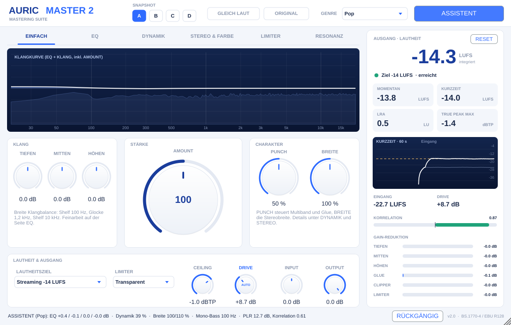

# Auric Master 2 – Mastering-Suite (VST3 / AU)

Komplett neu aufgebautes Mastering-Plugin. Die alte Version (Auric Master 1) bleibt unverändert im Hauptordner des Repos.



## Signalkette

```
Input → Resonanz-Kontrolle (FFT) → Low Cut → 4-Band-EQ (Stereo/Mitte/Seite) + KLANG-Makros
      → 3-Band-Multiband-Kompression (Linkwitz-Riley, phasenrichtig) → Bandsättigung WÄRME + Exciter GLANZ
      → Stereobreite je Band + Mono-Bass → Glue-Kompressor
      → Drive (manuell oder Lautheitsziel-Automatik) → Soft-Clipper → True-Peak-Limiter (4× Oversampling)
      → True-Peak-Wächter → Output-Trim
```

Latenz: ca. 48 ms (wird von FL Studio automatisch ausgeglichen).

## Bedienung: EINFACH + Profi-Seiten

| Seite | Inhalt |
|-------|--------|
| **EINFACH** | Klangkurve, KLANG (Tiefen 100 Hz / Mitten 1,2 kHz / Höhen 10 kHz), großer **AMOUNT**-Regler (Gesamtintensität aller Stufen), PUNCH, BREITE, Lautheitsziel, Limiter-Charakter, Ceiling, Drive, Input/Output |
| **EQ** | 4 Bänder (Low Shelf, 2 Glocken, High Shelf) mit Modus Stereo / Mitte / Seite, Low Cut (24 dB/Okt.). Punkte in der Kurve ziehen, Mausrad = Q, Doppelklick = Reset. Mitte- und Seiten-Kurve werden getrennt angezeigt |
| **DYNAMIK** | 3 Bänder mit Live-Gain-Reduktion, Crossover-Linien direkt ziehbar, Stärke + Pegel je Band, Tempo, Glue-Kompressor, Punch |
| **STEREO & FARBE** | Vektorskop + Korrelation, Breite (Makro, Mitten, Höhen), Mono-Bass, WÄRME (Tape-Bandsättigung), GLANZ (pegelabhängiger Exciter) |
| **LIMITER** | Verlauf der Kurzzeit-Lautheit (20 s) mit Ziellinie, Arbeit von Limiter und Clipper, Lautheitsziel, Drive, Ceiling, Clipper, Charakter (Transparent / Punchy / Laut) |
| **RESONANZ** | Dynamische Resonanzkontrolle mit 6 ziehbaren Bändern, Live-Spektrum und Reduktions-Verlauf |

**Immer sichtbar (rechts):** integrierte Lautheit (LUFS), Momentan, Kurzzeit, LRA, True-Peak-Maximum, 60-s-Verlauf (Ausgang + Eingang), Eingangslautheit, Drive, Korrelation und Gain-Reduktion aller Stufen. RESET startet die Messung neu.

**Kopfzeile:**
- **A B C D** – vier Snapshots zum schnellen Vergleichen (werden mit dem Projekt gespeichert).
- **GLEICH LAUT** – fairer Vergleich: die lautere Version wird leiser gemacht (nie lauter, also keine Übersteuerung). Nur zum Hören, vor dem Export ausschalten.
- **ORIGINAL** – Bypass, latenzausgeglichen.
- **GENRE + ASSISTENT** – siehe unten.

Das Fenster lässt sich frei skalieren (60–160 %); Größe und zuletzt geöffnete Seite werden im Projekt gespeichert.

## Auto-Master-Assistent

1. Genre wählen (Pop, Hip-Hop / Trap, EDM, Rock, Acoustic), **ASSISTENT** klicken.
2. Song abspielen – am besten einen typischen, vollen Teil (Refrain). Der Assistent hört 15 s zu (Stille wird ignoriert).
3. Danach setzt er:
   - **EQ**: vergleicht die Langzeit-Klangbalance mit der Genre-Referenz und korrigiert ca. 60 % der breiten Abweichung (max. ±4 dB) – der Charakter des Mixes bleibt erhalten.
   - **Dynamik**: aus dem Verhältnis Spitzenpegel zu Lautheit (PLR) – ein offener Mix bekommt mehr Multiband/Glue, ein schon komprimierter wenig.
   - **Breite**: aus der Korrelation über 300 Hz (sehr breit → schmaler, sehr schmal → etwas breiter).
   - **Mono-Bass**: 150 Hz, wenn im Bass viel Stereo-Anteil ist, sonst 100 Hz.
   - **Farbe, Limiter-Charakter, Resonanz-Bänder** und – falls aus – das Lautheitsziel *Streaming −14 LUFS*.
4. Die Zusammenfassung erscheint unten; **RÜCKGÄNGIG** stellt alles auf den Stand davor zurück.

Die Analyse misst das Eingangssignal *vor* der Bearbeitung – erneutes Ausführen liefert dasselbe Ergebnis und addiert sich nicht auf. Der Assistent ist ein Startpunkt, kein Ersatz fürs Hören: danach mit AMOUNT und den KLANG-Reglern nach Geschmack anpassen.

## Lautheitsziel-Automatik

| Ziel | Integrierte Lautheit |
|------|----------------------|
| Streaming (Spotify, YouTube, Tidal, Amazon) | −14 LUFS |
| Apple Music | −16 LUFS |
| Laut / Sehr laut / Club | −11 / −9 / −7 LUFS |
| Aus | Drive manuell |

Die Automatik misst nach **ITU-R BS.1770-4 / EBU R128** und regelt den Drive weich nach, bis das Ziel erreicht ist (grüner Punkt „erreicht“). Ceiling (Standard −1 dBTP) und True-Peak-Grenze werden immer eingehalten. Hinweis: Die Plattform-Werte sind die üblichen Normalisierungsziele der Dienste (Stand der Recherche); Plattformen ändern sie gelegentlich. Lautere Master werden dort einfach leiser abgespielt. Sehr leise Mixe (unter ca. −33 LUFS) erreichen laute Ziele nicht allein über den Drive (max. +24 dB) – dann INPUT anheben.

## Getestet (Offline-Test-Suite `tests/TestMain.cpp`)

- K-Gewichtung exakt wie BS.1770-Tabelle, EBU-Testfälle 44,1/48/96 kHz auf ±0,03 LU, LRA exakt, True Peak auf ±0,04 dB
- Multiband-Summe flach (0,001 dB), neutrale Einstellung transparent (−0,004 dB)
- Lautheitsziele auf ±0,04 LU getroffen, True Peak immer unter dem Ceiling
- Wiedergabestart mit Ziel −14 LUFS: kein Lautheitsbuckel (max. −13,6 LUFS Kurzzeit), nach 20 s auf −14,0
- Gleich-laut-Vergleich auf ±0,1 LU, Mono-Bass, Snapshots, große Host-Puffer identisch
- Assistent mit Material bekannter Klangbalance: neutral → EQ ±0,4 dB; +6 dB Bass → Low Shelf −2,6 dB; −6 dB Höhen → High Shelf +3,0 dB; komprimierter Mix → weniger Dynamik; sehr breiter Mix → schmaler + Mono-Bass 150 Hz; Rückgängig korrekt
- CPU ca. 8 % eines Kerns (48 kHz, alle Module an)

## Installation

Die fertigen Plugins baut GitHub Actions automatisch (Tab *Actions* → neuester Lauf → Artefakte):
- `AuricMaster2-VST3-Windows`
- `AuricMaster2-macOS` (VST3 + AU, Universal: Apple Silicon + Intel)

### Windows (FL Studio)
1. Artefakt entpacken, `Auric Master 2.vst3` nach `C:\Program Files\Common Files\VST3\` kopieren.
2. FL Studio → *Options → Manage plugins → Find plugins*.
3. Im Mixer auf einen Insert-Slot (z. B. Master) → *Auric Master 2*.

### macOS (FL Studio)
1. `AuricMaster2-macOS` herunterladen und im Ordner *Downloads* entpacken (ggf. die innere `AuricMaster2-macOS.zip` noch einmal doppelklicken), sodass `~/Downloads/dist/` entsteht.
2. Terminal öffnen und ausführen:
   ```
   mkdir -p ~/Library/Audio/Plug-Ins/VST3 ~/Library/Audio/Plug-Ins/Components && cp -R ~/Downloads/dist/"Auric Master 2.vst3" ~/Library/Audio/Plug-Ins/VST3/ && cp -R ~/Downloads/dist/"Auric Master 2.component" ~/Library/Audio/Plug-Ins/Components/ && xattr -dr com.apple.quarantine ~/Library/Audio/Plug-Ins/VST3/"Auric Master 2.vst3" ~/Library/Audio/Plug-Ins/Components/"Auric Master 2.component" && echo "Installiert!"
   ```
3. FL Studio → *Options → Manage plugins → Find installed plugins* → Stern bei *Auric Master 2*.
4. Falls es nicht erscheint: `killall -9 AudioComponentRegistrar; auval -v aufx AuM2 Auri` und FL Studio neu starten.

## Selbst bauen

```
cmake -S AuricMaster2 -B build-am2            # Windows zusätzlich: -A x64
cmake --build build-am2 --config Release --target AuricMaster2_VST3
# Tests:
cmake -S AuricMaster2 -B build-am2 -DAM2_BUILD_TESTS=ON
cmake --build build-am2 --target AM2Tests && ./build-am2/AM2Tests_artefacts/Release/AM2Tests
```
